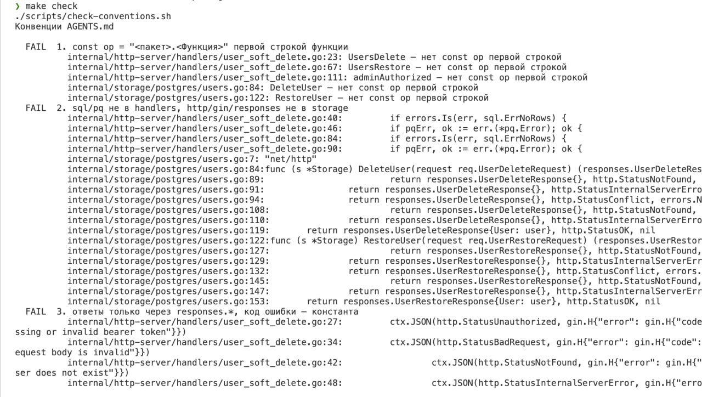
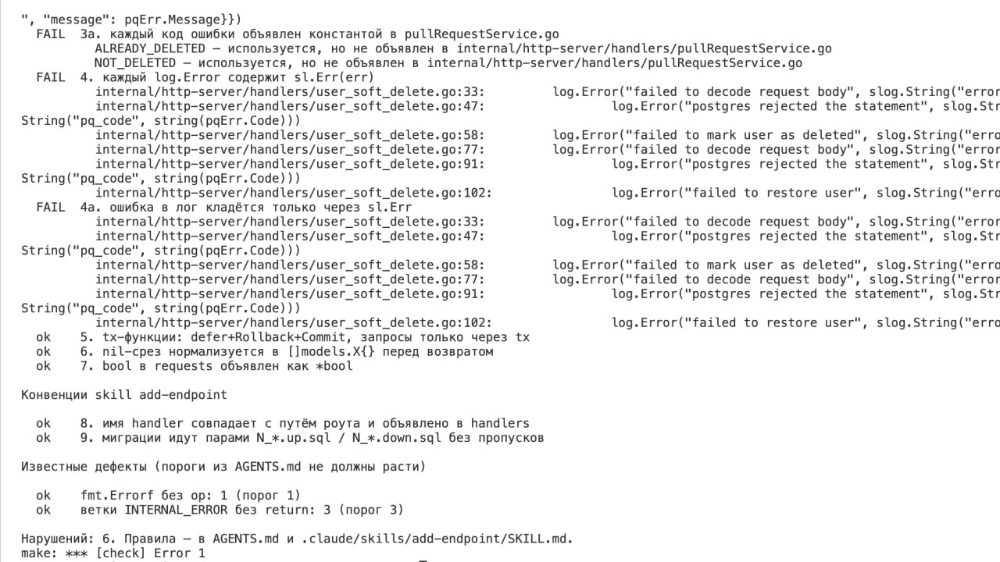
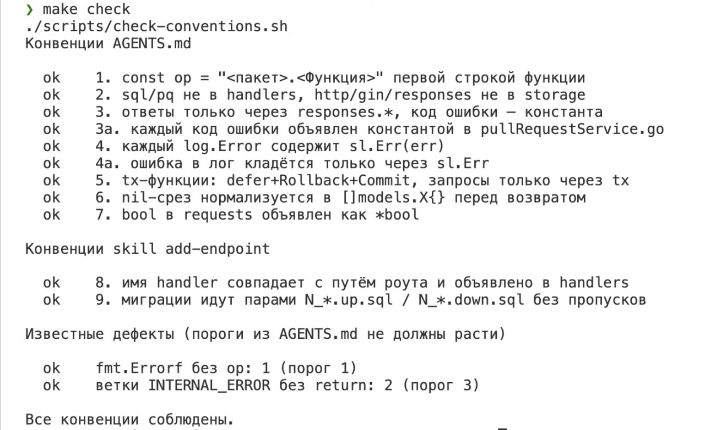
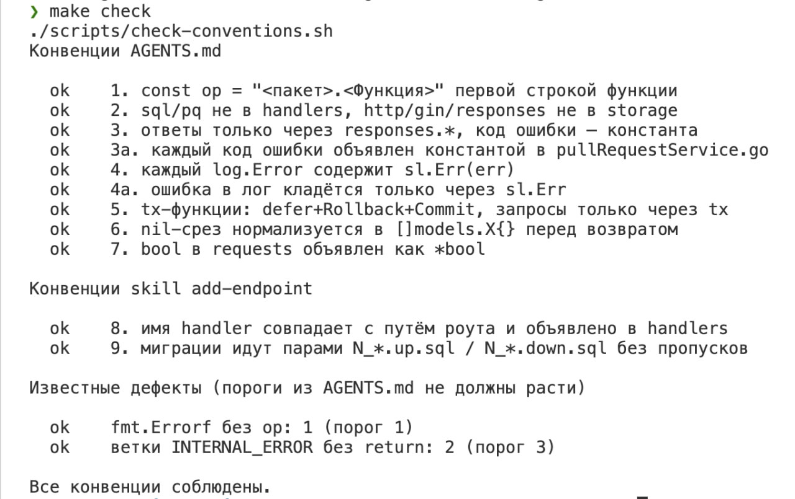

# Лабораторная работа «Context engineering: AGENTS.md и skill»

Выполнили: Ахмедов Бахадыр, Мелихов Андрей, Трофименко Егор, Эль Хеннави Александр

## 1. Кодовая база

Мы выбрали вариант А условия, то есть собственный репозиторий. Это сервис назначения ревьюеров на pull request, который один из участников команды написал осенью 2025 года как тестовое задание на стажировку в Авито. Широко репозиторий не публиковался, так что заранее знать его конвенции агенту было неоткуда.

Сервис написан на Go 1.24 с Gin, `database/sql` и PostgreSQL, миграции применяет golang-migrate, сервис и база поднимаются через docker-compose. Роуты объявлены в `cmd/pullRequestService/main.go`, зависимости собираются в `internal/app`, хендлеры лежат в `internal/http-server/handlers`, запросы к базе в `internal/storage/postgres`, DTO запросов и ответов в `internal/transport/http/requests` и `responses`. Хендлер обращается к storage через интерфейсы-провайдеры. Проверки состояния и выбор ревьюеров по соглашению проекта находятся в storage, а хендлер только разбирает запрос и формирует ответ.

| Пункт чек-листа шага 0 | Результат |
|---|---|
| Выраженное разделение слоёв | есть: хендлеры, storage, DTO, модели, сборка зависимостей |
| Размер 1000-10000 строк | 1335 строк Go в 23 файлах и 4 файла миграций |
| Тесты, которые реально запускаются | нет, в проекте нет ни одного `_test.go` |
| 5-7 неочевидных конвенций | 7, вынесены в AGENTS.md |
| Популярный стек | Go, Gin, PostgreSQL |

Не выполнен один пункт из пяти. Условие советует сменить репозиторий, когда не выполняются два-три пункта, поэтому мы оставили этот. Вместо тестов skill требует от агента собрать проект, запустить `go vet` и `make check` и проверить новую ручку запросами `curl` по семи пунктам.

## 2. Как проводились прогоны

Чистое состояние кода зафиксировано коммитом `8d2ecaa`, от него начинаются ветки прогонов 1 и 2. Каждый прогон выполнялся на отдельной ветке, а результат работы агента сохранялся одним коммитом.

Во всех прогонах агент решал одну и ту же задачу, мягкое удаление пользователя. Запись остаётся в таблице `users` с отметкой `deleted_at`, удалённый пользователь исключается из состава команды и из кандидатов в ревьюеры, а отдельная ручка его восстанавливает. Задача затрагивает все слои проекта: миграцию, sentinel-ошибки, storage, интерфейс-провайдер, DTO, хендлер и роут.

Текст промпта: Мягкое удаление (soft delete) сущности — вместо реального удаления запись помечается как удалённая (deleted_at/is_deleted), исключается из обычных списков, но остаётся в базе; нужен эндпоинт восстановления.

| Ветка | Модель | Что было у агента |
|---|---|---|
| `baseline-attempt-1` | opus 5.5 | только код проекта |
| `baseline-attempt-2` | opus 5.5 | только код проекта |
| `baseline-attempt-1-with-skills` | opus 5.5 | код, AGENTS.md и skill |
| `baseline-attempt-3` | opus 5.5 | только код проекта |
| `baseline-attempt-4-grok` | Grok | только код проекта |
| `baseline-attempt-5-grok` | Grok | код, AGENTS.md и skill, без скрипта проверки |

 Прогоны 4 и 5 выполнены на Grok, поэтому на этой модели есть пара «без правил» и «с правилами» на одной и той же задаче.

Прогон с правилами на модели А стартовал с коммита `0e0f41c`. В нём уже были AGENTS.md и skill, но ещё не было скрипта проверки, поэтому агент работал только по тексту правил и не мог подогнать код под проверку. В прогонах 3 и 4 AGENTS.md, skill и скрипт перед запуском удалялись отдельным коммитом (для прогона 3 это `1663a87`). На ветки без правил скрипт добавлен уже после коммита агента, так что агент его не видел. В прогоне 5 на Grok AGENTS.md и skill оставлены, а скрипт удалён, чтобы проверить, соблюдает ли модель правила без инструмента, который сам покажет ей нарушения.

## 3. AGENTS.md, skill и скрипт проверки

В AGENTS.md (132 строки) собраны инварианты, которые действуют при любой правке. Каждое правило сформулировано как конкретное требование с отдельным пунктом «Не делать», у большинства есть пример кода, и для каждого в скрипте есть проверка.

| № | Правило | Где описано | Как проверяет скрипт |
|---|---|---|---|
| 1 | Функция хендлера и storage начинается с `const op = "<пакет>.<Функция>"`, в storage `op` уходит в обёртку ошибки, в хендлере в логгер | AGENTS.md, §1 | awk по объявлениям `func` |
| 2 | Ошибки драйвера БД переводятся в sentinel-ошибки и не выходят за storage, storage не знает про HTTP | AGENTS.md, §2 | grep `sql.ErrNoRows` и `pq.` в хендлерах, `net/http`, gin и `responses.` в storage |
| 3 | Клиенту уходит только типизированный ответ, ошибка через `responses.Error` с константой кода | AGENTS.md, §3 | grep `gin.H`, `map[string]`, ответов с ошибкой без `responses.Error` и строковых кодов, сверка кодов с блоком констант |
| 4 | Ожидаемые 4xx пишутся в `log.Info`, 5xx в `log.Error` с `sl.Err(err)` | AGENTS.md, §4 | grep `log.Error` без `sl.Err` |
| 5 | Многошаговая запись идёт в транзакции и только через `tx` | AGENTS.md, §5 | awk по функциям с `Begin()` |
| 6 | Срез из storage не бывает `nil` | AGENTS.md, §6 | awk по методам, которые возвращают срез |
| 7 | Флаг в теле запроса объявлен как `*bool` | AGENTS.md, §7 | grep по `requests` |
| 8 | Имя хендлера выводится из пути роута | skill | разбор роутов в `main.go` |
| 9 | Миграции идут парами `N_init.up.sql` и `N_init.down.sql` без пропусков | skill | проверка файлов в `migrations/` |

Кроме правил, в AGENTS.md перечислены известные дефекты с номерами строк (`users.go:52`, `team.go:81`, `pullrequest.go:54` и другие), чтобы агент не брал их за образец и исправлял, если правит код рядом. Скрипт следит, чтобы таких мест не становилось больше. Веток `INTERNAL_ERROR` без `return` должно быть не больше трёх, `fmt.Errorf` без `op` не больше одного.

Skill `add-endpoint` лежит в `.claude/skills/add-endpoint/SKILL.md` (230 строк). Он задаёт порядок работы снизу вверх: миграция, DTO, sentinel-ошибка, метод storage, интерфейс-провайдер, хендлер, роут и README. В skill есть скелет хендлера, таблица соответствия sentinel-ошибок HTTP-статусам и требования, которых нет в AGENTS.md. Например, ответ с одним пользователем отдаётся существующим типом `responses.UserResponse`, а колонку `team_name`, которая может быть `NULL`, нужно читать в `sql.NullString`. AGENTS.md только ссылается на skill и не пересказывает его, а описание skill подсказывает агенту читать его при добавлении или изменении HTTP-ручки.

Скрипт `scripts/check-conventions.sh` написан на bash с grep и awk, LLM в проверке не участвует. Он запускается командой `make check` и печатает по каждому правилу `ok` или `FAIL` со списком файлов и строк. В конце скрипт выводит «Нарушений: N» или, если нарушений нет, «Все конвенции соблюдены». N здесь равно числу проваленных правил, поэтому пять функций без `const op` дают одно проваленное правило. На ветке `main`, где к чистому коду добавлены только AGENTS.md и skill, скрипт нарушений не находит.

## 4. Результаты

| Ветка | Модель | Правила | `make check`, проваленных правил | Что нашёл скрипт |
|---|---|---|---|---|
| `baseline-attempt-1` | opus 5.5 | нет | 0 | |
| `baseline-attempt-2` | opus 5.5 | нет | 0 | |
| `baseline-attempt-1-with-skills` | opus 5.5 | есть | 0 | веток `INTERNAL_ERROR` без `return` стало 2 вместо 3 |
| `baseline-attempt-3` | opus 5.5 | нет | 0 | |
| `baseline-attempt-4-grok` | Grok | нет | 6 | правила 1, 2, 3, 3a, 4 и 4a: пять функций без `const op`, `sql.ErrNoRows` и `pq.Error` в хендлерах, `net/http` и `responses` в storage, ответы через `gin.H`, два необъявленных кода ошибок, шесть `log.Error` без `sl.Err` |
| `baseline-attempt-5-grok` | Grok | есть | 0 | веток `INTERNAL_ERROR` без `return` стало 2 вместо 3 |

Нагляднее всего разница видна на Grok, где обе ветки сделаны на одной модели и по одной задаче. Без правил скрипт нашёл нарушения в шести проверках из тринадцати (рисунки 1 и 2), с AGENTS.md и skill ни одного (рисунок 3). Скрипт в прогоне 5 был удалён, так что агент не мог запустить проверку и исправить код под неё.

Рисунок 1. Вывод `make check` на ветке `baseline-attempt-4-grok`, правила 1-3

Рисунок 2. Вывод `make check` на ветке `baseline-attempt-4-grok`, правила 3a-9 и итог

Рисунок 3. Вывод `make check` на ветке `baseline-attempt-5-grok`

На модели А скрипт разницы не показал. Обе ветки без правил проходят проверку так же, как ветка с правилами, потому что модель А и без AGENTS.md повторяла то, что видно в соседнем коде: `const op` в начале каждой функции, логгер с `op`, `responses.Error` с константой кода, перевод `sql.ErrNoRows` в sentinel-ошибку. Поэтому мы дополнительно сверили диффы прогонов 1-4 вручную по требованиям, которые скрипт не проверяет или проверяет не полностью. Плюс в таблицах означает, что требование выполнено, минус означает нарушение.

Первую группу требований существующий код соблюдает везде, кроме одного места из списка известных дефектов (`team.go:39`).

| Требование | 1 (Opus 5.5) | 2 (Opus 5.5) | с правилами (Opus 5.5) | 3 (Opus 5.5) | 4 (Grok) |
|---|---|---|---|---|---|
| Ошибка клиенту только через `responses.Error` (AGENTS.md, §3) | + | + | + | + | − |
| Непредвиденная ошибка пишется в `log.Error` с `sl.Err` (AGENTS.md, §4) | + | + | + | + | − |
| Ошибка из storage обёрнута с `op` (AGENTS.md, §1) | + | + | + | + | − |

Вторая группа взята из skill, и в существующем коде у каждого такого требования есть контрпример.

| Требование skill | Что есть в коде | 1 (Opus 5.5) | 2 (Opus 5.5) | с правилами (Opus 5.5) | 3 (Opus 5.5) | 4 (Grok) |
|---|---|---|---|---|---|---|
| Ответ с одним пользователем через `responses.UserResponse` (шаг 2) | `UsersSetIsActive` отвечает `UserResponse`, но для PR заведены два одинаковых типа ответа | − | + | + | − | − |
| `team_name` читается в `sql.NullString` (шаг 4) | `SetIsActive` читает `team_name` в `string` | + | − | + | + | _ |
| Конфликт состояния отдаёт 409 (таблица статусов) | четыре конфликта отдают 409, `TEAM_EXISTS` отдаёт 400 | + | − | + | + | + |

По первой группе без правил ошибся только прогон 4 на Grok, в нём нарушены все три требования, и два из них скрипт тоже поймал (правила 3 и 4). По второй группе прогоны модели А без правил выбирали разные варианты, прогон 1 разошёлся со skill в одном месте, а прогон 2 в двух. Прогон с правилами во всех трёх местах выбрал вариант из skill. На Grok прогон без правил провалил 6 проверок скрипта из 13, а прогон с правилами на той же модели прошёл все.

## 5. Какие ошибки агент совершал без правил

Модель А не нарушила ни одного требования, которое код соблюдает последовательно. Расхождения появились там, где в самом коде есть примеры двух вариантов. В прогоне 1 агент завёл типы `UserDeleteResponse` и `UserRestoreResponse`, которые повторяют `UserResponse`, так же как в коде уже повторяют друг друга `PullRequestCreateResponse` и `PullRequestMergeResponse`. В прогоне 2 агент переиспользовал `UserResponse`, зато прочитал `team_name` в поле типа `string`, как это сделано в существующем `SetIsActive`. Колонка объявлена с `ON DELETE SET NULL`, и для пользователя без команды `Scan` вернёт ошибку, после чего ручка ответит 500. В том же прогоне восстановление неудалённого пользователя отдаёт 400, как `TEAM_EXISTS`, хотя остальные четыре конфликта состояния в сервисе отдают 409. Ни один из двух прогонов не исправил известный дефект в `UsersSetIsActive`, хотя оба добавляли хендлеры в тот же файл `users.go`.

Прогон 3 на модели Б похож на прогон 1: он тоже завёл отдельные типы ответа, но вдобавок переформатировал четыре существующих файла (`models/user.go`, `requests/user-request.go`, `responses/user-response.go` и блок констант в `pullRequestService.go`), из-за чего в дифф попали строки, не связанные с задачей.

Сильнее всех ошибался Grok в прогоне 4. Он вынес хендлеры в отдельный файл `user_soft_delete.go` и не соблюдал почти ни одной конвенции проекта. В пяти новых функциях нет `const op`. Хендлеры сами разбирают ошибки драйвера (`sql.ErrNoRows`, `*pq.Error`), а storage, наоборот, импортирует `net/http`, возвращает готовые `responses.UserDeleteResponse` и `responses.UserRestoreResponse` вместе с HTTP-статусом, и хендлер отдаёт клиенту статус, который выбрал storage. Слои в этом месте перемешаны в обе стороны. Ответы об ошибках собраны через `gin.H` со строковыми кодами, причём при ошибке Postgres клиенту уходит текст `pqErr.Message`, то есть внутреннее сообщение базы данных. Коды `ALREADY_DELETED` и `NOT_DELETED` использованы, но не объявлены в блоке констант. Все шесть вызовов `log.Error` пишут ошибку через `slog.String("error", err.Error())` вместо `sl.Err(err)`. Ошибки из storage возвращаются без обёртки с `op`, и по тексту ошибки нельзя понять, в какой функции она возникла.

## 6. Какими правилами они устранены

В прогоне с правилами на модели Opus 5.5 (`baseline-attempt-1-with-skills`) агент во всех трёх спорных местах поступил так, как требует skill. Обе ручки отвечают существующим `responses.UserResponse` (шаг 2). `team_name` читается в `sql.NullString` в обоих новых методах, причём агент исправил и существующий `SetIsActive`, о котором предупреждает шаг 4. Восстановление неудалённого пользователя отдаёт 409 `USER_NOT_DELETED` по таблице статусов. Кроме того, агент добавил недостающий `return` в `UsersSetIsActive`, как AGENTS.md требует поступать с известными дефектами рядом с правкой, и в выводе скрипта число веток `INTERNAL_ERROR` без `return` снизилось с 3 до 2. Похоже, явное указание в skill перевешивает противоречивые примеры в коде, но это вывод по одному прогону.

Все ошибки прогона 4 прямо описаны в AGENTS.md: §1 (`const op` и обёртка ошибок), §2 (ошибки драйвера не выходят за storage, storage не знает про HTTP), §3 (ответы только через `responses.Error` с объявленной константой) и §4 (`log.Error` с `sl.Err`). Прогон 5 на той же модели с AGENTS.md и skill прошёл все проверки скрипта: `const op` есть во всех функциях, ошибки драйвера не выходят за storage, ответы идут через `responses.Error` с объявленными константами, а `log.Error` пишет ошибку через `sl.Err`. Кроме того, Grok, как и модель А в прогоне с правилами, исправил один известный дефект, и веток `INTERNAL_ERROR` без `return` стало 2 вместо 3. Скрипта при этом в репозитории не было, то есть модель соблюдала правила, не имея возможности проверить себя.

## 7. Какие инструкции оказались бесполезными

Правила §5, §6 и §7 и оба правила skill, которые проверяет скрипт (имя хендлера по пути роута и парные миграции), не нарушил ни один прогон, в том числе без правил. Задача о мягком удалении обходится без транзакции, не возвращает срезов и не принимает флагов в теле запроса, так что §5, §6 и §7 в этом эксперименте просто не понадобились. Имена хендлеров и формат миграций хорошо видны в существующем коде, и все модели повторили их без подсказки. Правила §1-§4 модель А соблюдала и без AGENTS.md, а нарушил их только Grok в прогоне 4, так что для Grok они оказались нужны. Правила §5-§7 мы оставили, потому что они короткие и описывают реальные места кода. Многошаговая запись есть в `SavePullRequest`, срезы возвращают `ReadTeam` и `ReadReviewUsers`.

Несколько инструкций оказались неточными. Заголовок правила §4 требует `log.Info` для 4xx, но все существующие хендлеры и скелет из skill пишут ошибку разбора тела запроса (400) в `log.Error`. Агенты в прогонах 1-3 и в прогоне с правилами сделали так же, как в коде, и скрипт этот случай не проверяет. Заголовок нужно сузить до ситуаций, перечисленных в тексте самого правила: не найдено, конфликт, невалидный токен. Требования skill из второй группы противоречат части существующего кода, и только про чтение `team_name` skill об этом предупреждает. Про одинаковые типы ответов PR и код 400 у `TEAM_EXISTS` в skill ничего не сказано. Агент с правилами во всех трёх случаях выбрал вариант из skill, однако другая модель может пойти за примером из кода, поэтому оба исключения нужно назвать в skill прямо. Ещё одна неточность была в той версии skill, с которой работал прогон с правилами. Там сказано, что инварианты AGENTS.md «проверяются грепами, перечисленными там же», но в AGENTS.md не было ни одного grep. В коммите `d744310` эта строка заменена на `make check`.

У самого скрипта есть слепые места. Правило 3 ищет только строки с `ctx.JSON(`, и ответ через переменную контекста с другим именем оно пропустит. Отсутствие логирования скрипт не замечает. Обёртку ошибок он проверяет только по `fmt.Errorf` без `op`, а `return ..., err` без обёртки не считает. Требования из ручной сверки тоже можно проверять автоматически, и в следующей версии скрипта мы бы начали с них.

## 8. Generalization-тест

Для второго задания мы взяли из списка условия экспорт данных пользователя и дали агенту промпт: «Добавь эндпоинт/кнопка собирает данные пользователя из нескольких таблиц/сервисов в один файл (JSON/CSV), с проверкой прав доступа (только свои данные)». Задача структурно похожа на первую, потому что тоже требует новой ручки через все слои, но в остальном другая: ничего не удаляет и не меняет схему, а собирает данные из нескольких таблиц и проверяет права доступа. AGENTS.md и skill под неё не менялись.

Рисунок 4. Вывод `make check` на ветке второго задания

| Ветка | Модель | Правила | `make check`, проваленных правил |
|---|---|---|---|
| baseline-attempt-4-grok | Grok | есть | 0 |

Скрипт не нашёл ни одного нарушения (рисунок 4). Все девять правил и оба порога по известным дефектам выполнены, а веток `INTERNAL_ERROR` без `return` снова стало 2 вместо 3, то есть агент и здесь исправил известный дефект рядом со своей правкой. Ни одно правило AGENTS.md не упоминает мягкое удаление, `deleted_at` или конкретные ручки первой задачи. Они описывают устройство проекта в целом: где живёт `op`, через какой слой проходят ошибки базы, как отвечать клиенту и как логировать. Поэтому на новой задаче они применились без изменений, и это подтверждает, что правила записаны как общий принцип, а не под один кейс. Прогона второго задания без правил мы не делали, поэтому по нему видно, что правила выдерживают новую задачу, но не видно, насколько они снижают число нарушений на ней.

## 9. Где что лежит

| Что сдаётся | Где |
|---|---|
| AGENTS.md | `AGENTS.md` в корне репозитория |
| Skill | `.claude/skills/add-endpoint/SKILL.md` |
| Check-скрипт | `scripts/check-conventions.sh`, запуск `make check` |
| Результаты прогонов | ветки `baseline-attempt-*`, рисунки 1-3 в `screenshots/` |
| Generalization-тест | ветка baseline-attempt-4-grok, рисунок 4 |
| Отчёт | `REPORT.md` |
